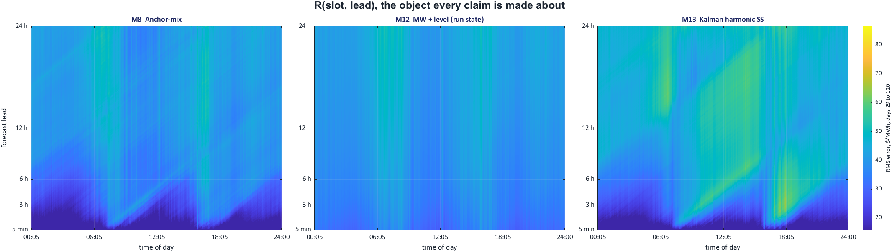
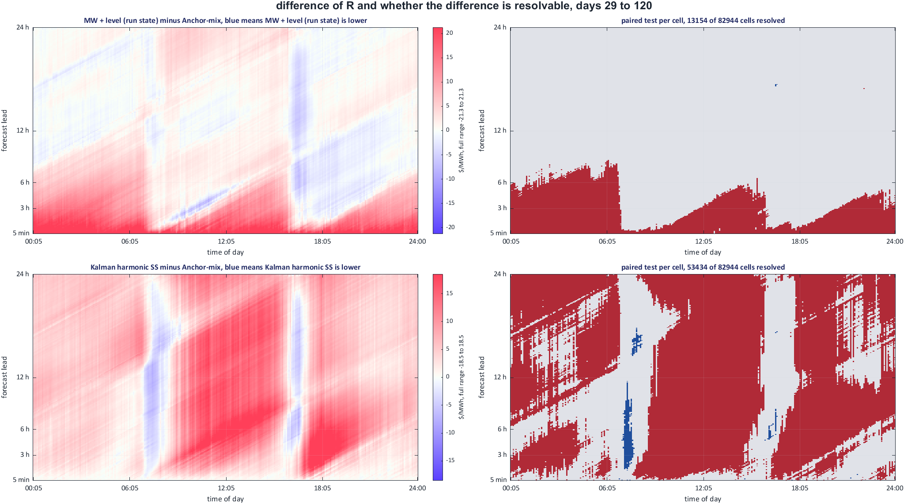
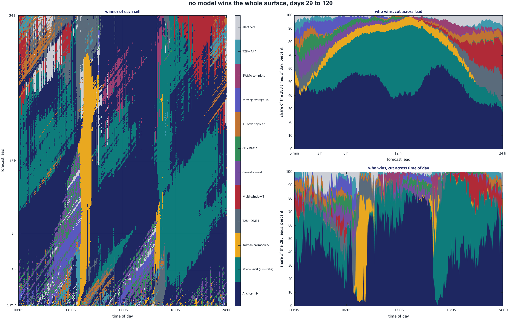
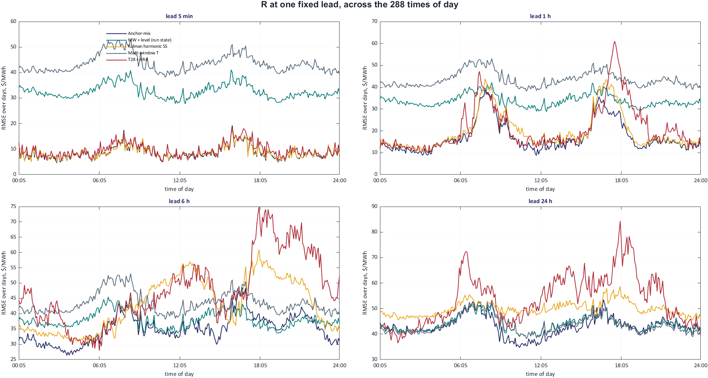
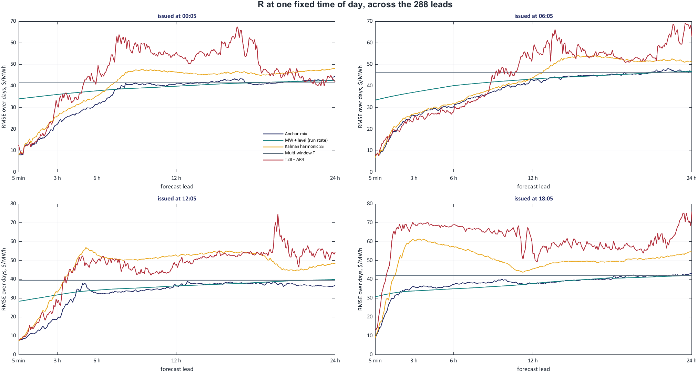
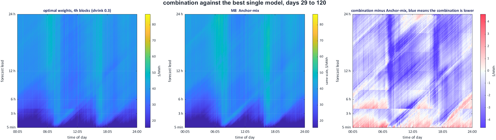
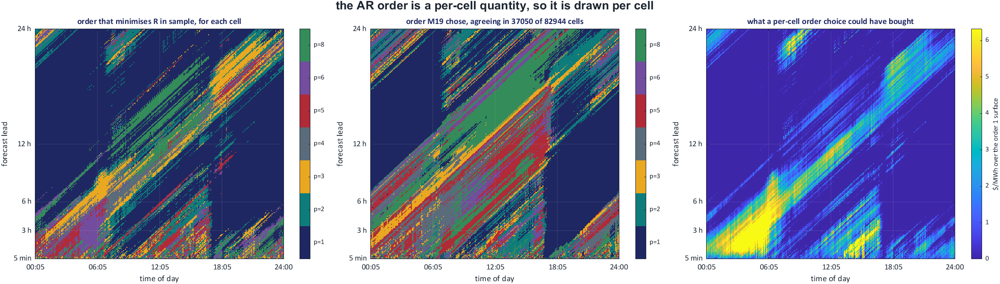

# 预测器图证 2026-10-13

配套三份:

- `HANDOVER_预测器交接_20261013.md`,做法与判据。
- `预测器数学模型与符号_20261013.md`,短号、key、显示名的对照,以及每个预测器的公式与符号。
- `HANDOVER_预测器整理与全跨度比较_20261013.md`,符号与公式的完整登记。

这份只放图与图里的数。图在 `predictor/figures/`。重出图的入口是 `Predicitor/report_surfaces.m`,画图代码在 `Predicitor/report_figures.m`。

## 0 读图前提

数据来自 `AEMO_Data/level_multiwindow_figs/atlas_v5.mat`。19 个模型,目标日 2026-02-01 至 2026-06-01,共 120 天。

`atlas_v5` 相对 `atlas_v4` 只动了一列:M19。它的候选系数原先用了一个含当前残差的回归量,见第 7 节,那是错的。两份日志的整图指纹逐行比,19 个模型里只有 M19 变了,49.27 变 47.20,其余 18 个一位不差。整图指纹在这里的用途只是确认改动没有外溢。

单模型与组合一律取第 29 至 120 个计分日,共 92 天,82,944 个格子。前 28 天是组合权重的取窗期,组合在那 28 天没有输出,为了让两类东西可比,单模型也只取后 92 天。

一个格子是一对(时刻, 预测时段)。

**合法对象只有四样**:整张 288 乘 288 的误差面;固定跨度时那 288 个时刻的剖面;固定时刻时那 288 个跨度的剖面;以及对整张面做一次逐格计数。整图 RMSE 只作运行指纹。

**只有相对比较,没有绝对比较。** 图里所有的数都是某两个量之差、或某个量沿一维的形状,没有一处用「某模型 RMSE 是多少所以它好」这种句式下结论。

## 1 图一 三张误差面



横轴是一天的 288 个时刻,纵轴是 288 个预测时段,颜色是该格子在 92 天上的均方根误差。三张面共用一套色标,范围 20 至 90 $/MWh。

三条面都随跨度抬升。这是全图最粗的一条结构。

M13 在 06:05 至 07:30 和 17:00 至 18:00 各有一条亮脊,一路延伸到 24 小时跨度,峰值接近 90。M8 在同样两个时刻也有脊,但暗得多。M12 三条里最平。

按时刻剖面的中位数比,5 分钟跨度上 M8 是 7.85,M13 是 8.15,M12 是 31.91。**M8 与 M13 在短跨度上几乎没有差别,M12 差出一大截。** 到 24 小时跨度,M8 是 42.71,M13 是 49.36,M12 是 43.15,**M13 反而落后了**。

所以 M13 的短板不在短跨度,在一些时段的中长跨度。这一点在图二第二行给出逐格证据。

## 2 图二 两组差,各自的差值与可判定性



两行。第一行是 M12 减 M8,第二行是 M13 减 M8。每行左边是 RMSE 之差,右边是逐格配对检验的判定图。左图蓝色表示被减数(该行第一个模型)更低。

按 RMSE 比大小:

| 比较 | 前者更低 | 后者更低 | 判定得了的格子 |
|---|---|---|---|
| M12 对 M8 | 25,983 格,31.3% | 56,961 格,68.7% | 13,154 格,15.9% |
| M13 对 M8 | 6,709 格,8.1% | 76,235 格,91.9% | 53,434 格,64.4% |

M13 与 M8 的差比 M12 与 M8 的差**更容易判定**,虽然 M13 赢的格子更少。原因是 M13 的劣势稳定,而 M12 的劣势时有时无。

M13 那 6,709 个胜格分布不均:第 1 个跨度上占 288 个时刻里的 66 个,第 12 个跨度只有 9 个,第 288 个跨度只有 2 个。**集中在最短的那一端。**

### 2.1 判定图怎么看,以及为什么不能当强弱图

判定图只有三种颜色:蓝格表示该行第一个模型的平方误差显著更小,红格表示第二个,灰格表示这两个模型在这一格上的差别判不出来。

**判定图不表示差别有多大。** 这是最容易被误读的地方,所以用一格实例走一遍。

取 00:05 发版、24 小时跨度那一格。M8 的 RMSE 是 44.448,M12 是 42.551,M12 低 1.897 $/MWh。配对检验统计量是 −0.870,双侧 p 值 0.384。**判不出来,是灰格。**

再看判定统计量的来路。它用的不是两个 RMSE 之差,而是**逐日平方误差之差**这个序列。那一格上,平方误差之差的均值是 −165.07,而它的离散程度极大:单个最大的那一天就占了全部绝对偏差的 8.1%,最大的三天占 17.5%。均值除以标准误,得到 −0.870。

一句话:**显不显著问的是「差别稳不稳」,不是「差别大不大」。** 一个格子上 RMSE 只差 0.2 却天天朝同一个方向,可以判显著;差 5 却全靠一两天撑起来,判不出来。

所以左右两张图本来就不该长得像。左图编的是幅度,右图编的是可信度。

### 2.2 判据是什么,为什么用它

图上一律不写判据。判据写在这里。

**配对 Diebold-Mariano 检验。** 每个格子有 92 天的成对样本,配对的是同一个目标时刻与同一个跨度,所以两边的天气、需求、机组状态全一样,差的就是模型本身。对每个格子算平方误差之差 `d_t = e_1t² − e_2t²`,检验它的均值是否为零。

**Newey-West 滞后 7 阶。** `d_t` 在日与日之间不是独立的白噪声:一次连续多日的价格尖峰会抬高好几天的误差。滞后 7 阶的异方差自相关一致估计把这份相关性算进方差里,否则标准误偏小、判定偏松。取 7 是因为周末效应在一周内衰减完。

**Benjamini-Hochberg 控制在 5%。** 一次要同时判 82,944 个格子。逐格各用 5% 的显著性水平,纯属噪声也会有四千多个格子被判显著。BH 控制的是错误发现率,即「判显著的那些里假的最多占 5%」,它比 Bonferroni 松得多,在这么多格子上还能保住功效。

**灰格不是「没有差别」。** 灰格是「这份数据判不出来」。把灰格读成「两者一样」是错的。

## 3 图三 谁赢了哪个格子,以及两个方向的切法



左图每个格子涂成该格冠军的颜色。右上把左图**沿跨度方向切**:横轴是跨度,纵轴是 288 个时刻里各模型的占比。右下**沿时刻方向切**:横轴是时刻,纵轴是 288 个跨度里各模型的占比。

只让 19 个单模型互相竞争,92 天的计数:

| 短号 | 模型 | 赢的格子 | 占比 |
|---|---|---|---|
| M8 | Anchor-mix | 38,721 | 46.68% |
| M12 | MW 加运行状态水平 | 20,076 | 24.20% |
| M13 | Kalman 谐波状态空间 | 3,870 | 4.67% |
| M6 | T28 加 DMS4 | 3,840 | 4.63% |
| M10 | Multi-window T | 3,173 | 3.83% |
| M5 | Carry-forward | 2,392 | 2.88% |
| M7 | CF 加 DMS4 | 2,149 | 2.59% |
| M19 | 按跨度选阶数 | 2,051 | 2.47% |
| M15 | 移动平均 1 小时 | 1,916 | 2.31% |
| M14 | EWMA 模板 | 1,340 | 1.62% |
| M4 | T28 加 AR4 | 1,202 | 1.45% |
| M2 | 模板 T28 | 1,168 | 1.41% |
| M17 | 移动中值 1 小时 | 503 | 0.61% |
| M3 | Theta-y 跟踪 | 241 | 0.29% |
| M18 | 星期类模板 | 217 | 0.26% |
| M16 | 移动平均 1 小时补偿 | 71 | 0.09% |
| M9 | T28 加水平偏移 | 14 | 0.02% |
| M1 | 昨日同时刻 | 0 | 0.00% |
| M11 | MW 加水平偏移 | 0 | 0.00% |

**没有一个模型赢过一半。这张计数表本身不是结论**,它把「在哪些格子上赢」压掉了。要看的是右边两张切图。

右上这张切图说,把 288 个时刻合在一起,每个跨度上的赢家在换人。下面这张表是它的四个切片,每一个数都是「那 288 个时刻里赢了多少个」:

| 跨度 | M8 | M12 | M10 | M13 | M6 | M4 | M7 | M19 |
|---|---|---|---|---|---|---|---|---|
| 5 分钟 | 72 | 0 | 0 | 31 | 29 | 26 | 76 | 16 |
| 1 小时 | 126 | 1 | 0 | 5 | 29 | 15 | 18 | 19 |
| 6 小时 | 154 | 71 | 0 | 17 | 0 | 0 | 10 | 0 |
| 24 小时 | 80 | 11 | 76 | 0 | 57 | 14 | 0 | 13 |

**M12 在 5 分钟跨度上一个时刻都赢不到,在 24 小时跨度上赢 11 个。** M10 在 1 小时以内赢 0 个,在 24 小时跨度上赢 76 个。M7 反过来,5 分钟跨度上赢 76 个,24 小时跨度上 0 个。M19 的 2,051 格里,6 小时跨度上只有 0 个,两头多。

右下这张切图说,把 288 个跨度合在一起,每个时刻上的赢家构成完全不同。00:05 到 05:00 一段 M8 占七成以上,18:05 之后又回到五成以上;两处塌陷分别落在 06:05 至 07:30 与 12:05 前后,那两段上 M8 的占比掉到三成以下,由另外三四个模型分掉。

**两张切图加左图,才是一件事的三种看法。** 只给左图说不清谁在什么时候赢,只给计数表更说不清。

切图上具体哪个颜色是哪个模型,以图例行末的 Anchor-mix 起算:**颜色条目自下而上对应表中自上而下的顺序**,最后一条是合并掉的「其余模型」。

## 4 图四 固定跨度,看一天 288 个时刻



四张子图各取一个固定跨度,横轴是 288 个时刻,纵轴是那 92 天上的均方根误差。

| 跨度 | 模型 | 最低的时刻 | 中位 | 最高的时刻 | 最高除最低 |
|---|---|---|---|---|---|
| 5 分钟 | M8 | 4.60 | 7.85 | 19.27 | 4.19 |
| 5 分钟 | M4 | 5.00 | 8.80 | 18.28 | 3.65 |
| 5 分钟 | M13 | 4.88 | 8.15 | 18.08 | 3.71 |
| 5 分钟 | M10 | 38.14 | 42.54 | 53.12 | 1.39 |
| 24 小时 | M8 | 34.69 | 42.71 | 53.46 | 1.54 |
| 24 小时 | M4 | 36.45 | 52.90 | 84.35 | 2.31 |
| 24 小时 | M13 | 45.36 | 49.36 | 58.66 | 1.29 |
| 24 小时 | M10 | 38.14 | 42.54 | 53.12 | 1.39 |

5 分钟跨度上 M8、M4、M13 三条缠在 4.6 至 19.3 一段,中位数分别是 7.85、8.80、8.15。

24 小时跨度上顺序全变。M4 的中位数从 8.80 抬到 52.90,最高的时刻 84.35,成了四条里最差的一条;M8 的中位数只从 7.85 抬到 42.71。

**同一个模型在同一个跨度上,换一个时刻能差四倍。**

M10 那两行的三个端点完全一样,不是巧合:M10 的输出与预测时段无关,288 个跨度上给的是同一个值。

## 5 图五 固定时刻,看 288 个跨度



四张子图各取一个固定时刻,横轴是 288 个跨度。

| 时刻 | 模型 | 最短跨度 | 中位 | 最长跨度 | 最长除最短 |
|---|---|---|---|---|---|
| 00:05 | M8 | 8.05 | 40.94 | 44.45 | 5.52 |
| 00:05 | M4 | 8.33 | 47.88 | 67.51 | 8.11 |
| 00:05 | M13 | 8.01 | 45.72 | 48.16 | 6.01 |
| 18:05 | M8 | 8.76 | 38.52 | 43.21 | 4.93 |
| 18:05 | M4 | 12.98 | 62.17 | 75.87 | 5.85 |
| 18:05 | M13 | 8.96 | 50.60 | 61.31 | 6.84 |
| 18:05 | M10 | 42.13 | 42.13 | 42.13 | 1.00 |

00:05 发的那一版,M4 在 1.5 小时以内最低,过 3 小时抬头,到 8 小时成了最高的一条。

18:05 那一版最能说明问题。最短跨度上 M4 是 12.98,只比 M8 的 8.76 差一点;到中位数就已经是 62.17 对 38.52。**同一个发版时刻,跨度一拉长,M4 就掉队。**

图四与图五互为对照:图四是横切,图五是纵切,缺一张都不足以支撑关于另一维的结论。

## 6 图六 组合对 M8



规则是**按 4 小时跨度分块拟合最优权重,协方差向对角收缩 0.3**,名字是 `optimal weights, 4h blocks (shrink 0.3)`。对手点名 M8。

**对手不能由 argmin 挑。** 面上每个跨度排出来的顺序都不一样,argmin 会悄悄挑中某一个特定归约下的赢家。这一版第一稿就是这么错的:用「最坏情况最小」挑,挑出了 M12,整段结论跟着反过来。

三张子图依次是:组合的面、M8 的面(同一色标)、两者之差。

按 RMSE 比,组合更低的有 71,758 格,占 86.5%;M8 更低的有 11,186 格,占 13.5%。中位差 1.571 $/MWh,组合侧。

**但 86.5% 这个数字把结构盖住了。** 按跨度拆开,288 个时刻里组合赢几个:

| 跨度 | 5 分钟 | 30 分钟 | 1 小时 | 2 小时 | 3 小时 | 6 小时 | 12 小时 | 24 小时 |
|---|---|---|---|---|---|---|---|---|
| 组合赢的时刻 | 13 | 50 | 72 | 153 | 244 | 234 | 288 | 244 |

**组合在短跨度上基本全输,到 2 小时刚过半,3 小时以后才稳定占优。** 18:05 那一行 288 个跨度里组合赢 282 个,06:05 那一行赢 239 个。

**所以这个组合是长跨度工具。** 拿它替换 M8 做短跨度预测会变差;它的价值在 2 小时以后,3 到 12 小时最明显。

把 19 个单模型和 14 条组合规则放在一起竞争,计数前四是:全等权 19,143 格占 23.08%,4 小时分块收缩 0.3 有 11,911 格占 14.36%,整图收缩 0.3 有 7,590 格占 9.15%,4 小时分块无收缩 6,250 格占 7.54%。这时 M8 只剩 1,336 格。

逐格检验上,组合显著更好的格子一个都没有,显著更差的有 30 个。这一条与上面「88% 的格子更低」不矛盾,读法与第 2.1 节一样:差别又宽又浅,单格判不出来。要判它得换聚合口径。

## 7 图七 自回归阶数是一个逐格的量



左图是**在样本内**、对每一个格子、在候选集里使 RMSE 最小的阶数。中图是 M19 因果地选出来的阶数。右图是「每个格子都能挑到最好阶数」相对「全部用一阶」能买到多少。

候选集是 `[1 2 3 4 5 6 8]` 七个。上一版是 `[1 2 3 5 8]`,跳过了 4,并从 5 直接跳到 8。

在样本内被选中的格子:

| 阶数 | 格子 | 占比 |
|---|---|---|
| p=1 | 50,559 | 60.96% |
| p=2 | 8,356 | 10.07% |
| p=3 | 6,336 | 7.64% |
| p=4 | 4,306 | 5.19% |
| p=5 | 3,602 | 4.34% |
| p=6 | 3,659 | 4.41% |
| p=8 | 6,126 | 7.39% |

M19 因果地选出来的格子:

| 阶数 | 格子 | 占比 |
|---|---|---|
| p=1 | 31,649 | 38.2% |
| p=2 | 9,662 | 11.6% |
| p=3 | 5,618 | 6.8% |
| p=4 | 7,898 | 9.5% |
| p=5 | 9,977 | 12.0% |
| p=6 | 6,000 | 7.2% |
| p=8 | 12,140 | 14.6% |

中图与左图的一致率是 37,050 除以 82,944,等于 44.7%。七选一,乱猜是 14.3%,所以这个一致率是有信息量的,但它当然不会等于一:左图是在样本内挑的,中图是拿 28 天滑动窗挑的。

M19 的选择随跨度变化,这是这一版最重要的形状:

| 跨度 | p=1 | p=2 | p=3 | p=4 | p=5 | p=6 | p=8 |
|---|---|---|---|---|---|---|---|
| 5 分钟 | 19.5% | 19.0% | 15.3% | 10.5% | 10.5% | 10.3% | 15.0% |
| 1 小时 | 17.0% | 9.3% | 10.3% | 10.2% | 15.0% | 13.9% | 24.2% |
| 3 小时 | 30.9% | 9.6% | 9.3% | 8.0% | 14.6% | 13.2% | 14.5% |
| 6 小时 | 45.6% | 10.4% | 7.0% | 5.9% | 9.6% | 7.3% | 14.3% |
| 12 小时 | 55.3% | 10.4% | 5.1% | 3.3% | 6.8% | 4.5% | 14.5% |
| 24 小时 | 45.5% | 17.7% | 11.6% | 5.0% | 6.5% | 7.5% | 6.1% |

**p=1 的份额随跨度上升,短跨度上它只占两成。** 这与独立跑的阶数扫描是同一个方向:扫描说 5 分钟最优 p=3,30 分钟与 1 小时最优 p=5,3 小时 p=2,6 小时以上 p=1。

右图给的是这件事的上限。若每个格子都能在样本内挑到最好的阶数,相对全部用一阶:中位增益 0.000 $/MWh,平均增益 0.946 $/MWh,最大增益 11.354 $/MWh。

**即使把阶数选到最好,一半以上的格子一分钱也买不到。** 阶数是一个逐格的量,但它值不了多少。

### 7.1 上一版为什么全选一阶

上一版 `atlas_v4` 上,M19 在 82,944 个格子上全部选了 p=1,一格例外都没有。当时记的是「形状可疑,原因未明」。现在查清了,是一个确定性的错。

候选系数是五套独立的 RLS,每套按自己的阶数维护。问题出在**回归量的取用时机**:

```
r_hist = [r; r_hist(1:end-1)];              % 先把当前残差插进去
...
rls_vector_step(r, r_hist(1:pc), ...)       % 再拿它当回归量
```

于是第 c 套的回归量是 `[r(k); r(k-1); ...; r(k-pc+1)]`,**拿当前残差预测它自己**。拟合必然塌到 `phi = [1; 0; ...]`。

而在这个系数下,迭代预测的滤波器是 `y(n) = y(n-1)`,**p=1 与 p>1 给出完全一样的预测**。候选之间精确相等,`min` 取第一个下标,那正好是 p=1。

对照组是主 `phi`:`hist` 的更新在主 `phi` 更新**之后**,所以它一直是错的对面。

改法是把候选那一段挪到 `r_hist` 更新之前,与 `hist` 的用法对齐。

`atlas_v5` 上新增了一行审计,直接报这件事:

```
cells where every candidate is identical to the last bit: 0 of 82944
```

修好之后 M19 的整图指纹从 49.27 变成 47.20。

## 8 这一轮改了什么

| 项目 | 改前 | 改后 |
|---|---|---|
| M19 累计量 | 按(时刻, 日, 阶数) | 按(时刻, 跨度, 日, 阶数) |
| M19 选择粒度 | 每个跨度一个阶数 | 每个格子一个阶数 |
| M19 候选回归量 | 含当前残差 | 用更新前的,与主 `phi` 对齐 |
| M19 候选集 | `[1 2 3 5 8]` | `[1 2 3 4 5 6 8]` |
| M19 结果 | 82,944 格全选 p=1 | p=1 占 38.2%,份额随跨度上升 |
| 组合评分日 | 全 120 天,含 28 天空白 | 第 29 至 120 天 |
| 组合权重取窗 | `trs(d, :)`,含当天 | `trs(d-1, :)` |
| 图二 | 只有 M12 对 M8,无方法说明 | 加 M13 对 M8,方法说明移出图外 |
| 图二色标 | 差值面没有色标 | 每个差值面配一条,标出量程 |
| 图二判定图朝向 | 相对差值面转了 90 度 | 对齐 |
| 图三右半 | 一张计数柱状图 | 沿跨度与沿时刻两张切图,计数改成表 |
| 图三配色 | 靠 MATLAB 隐式配色,图例对不上 | 逐条 patch 显式指定 |
| 图六版式 | 2 乘 2 四格,含一个单点剖面 | 1 乘 3 三格 |
| 图六的对手 | 用 argmin 选,选出了 M12 | 点名 M8 |
| 图七 | 整图最优那一个数 | 逐格最优阶数面,与因果选择并置 |

## 9 这一轮暴露的写法问题

出图脚本第一版用显示名去匹配模型,图集里存的却是注册表的显示标签而不是 key。匹配不到之后代码静默回退成前三个模型,于是图一画的不是 M8、M12、M13,图二整块被跳过。**静默回退是这类错误的根源。** 现在驱动件从 `model_registry()` 取 key 放进 `S.keys`,画图按 key 匹配按显示名标注,匹配不到直接报错。

第二个,图六第一版用 `min(max(R))` 挑对手,那是「最坏情况最小」,选出的是 M12 而不是 M8,结论跟着全错。**对手要点名,不能由归约挑。**

第三个,图三第一版色标标签数了 17 项而标签只给了 8 项,图例重复且和颜色对不上。现在加了长度一致性断言。

第四个,批量改文件时锚点末尾的换行被吃掉,下一行粘上来导致语法错,两次。替换前后行尾必须校验一致。

第五个,图二判定图建的是 `zeros(n_s, n_h)`,掩码却是转置过的 `(n_h, n_s)`。**矩阵是方阵时 MATLAB 不报错,按线性下标赋值,等于把赋值又转置了一次**,判定图相对差值面转了 90 度。方阵不检查形状,这类错只能靠肉眼或形状断言发现。现在掩码与目标矩阵同形。

第六个,图三的两张面积图靠 MATLAB 的隐式配色,图例与色块对不上。现在逐条 patch 显式指定,并断言配色表、标签、分组三者长度一致。

第七个,图二的差值面一开始没有色标。**没有色标的差值图等于只给形状不给量纲。**

## 10 还没答的问题

**分位数覆盖率 86.7%**,判据要 88% 至 92%,未达标。这一项没有图,要单独做。

**组合显著性的口径。** 组合有 86.5% 的格子 RMSE 更低却只有 30 格判定得出。逐格只有 92 个样本,按跨度块聚合后再判定更合适。这一条要先定口径再出图。

**H3 图集**,跨度 1 至 7 天,数据已齐,没开工。

**`run_ensemble_online_test.m`** 已经改成存 `E_cmb`,但还没有重跑,组合层对 MPC 的验收结论仍是旧图集上的。

**M19 值不值得留。** 修好之后它不再是常数,短期份额也确实随跨度变了,但第 7 节右图说即使每格都选到最好,中位增益是 0.000。是保留它、还是换成固定的一阶或五阶,要用同一套二维口径比一次再定。
